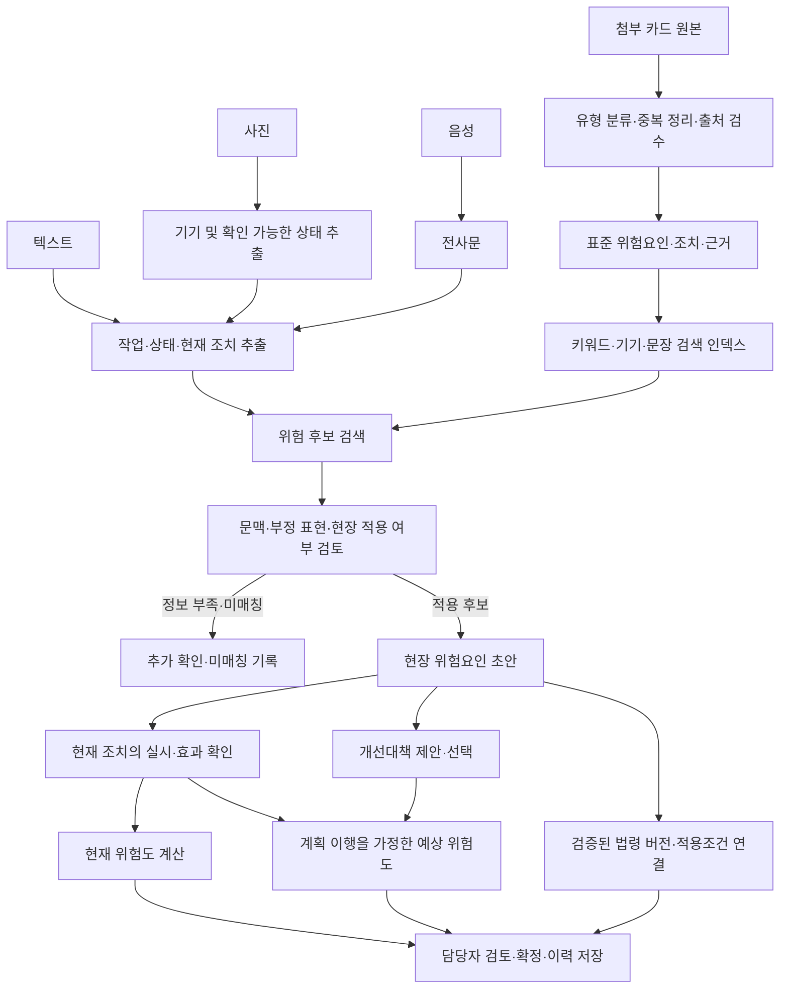
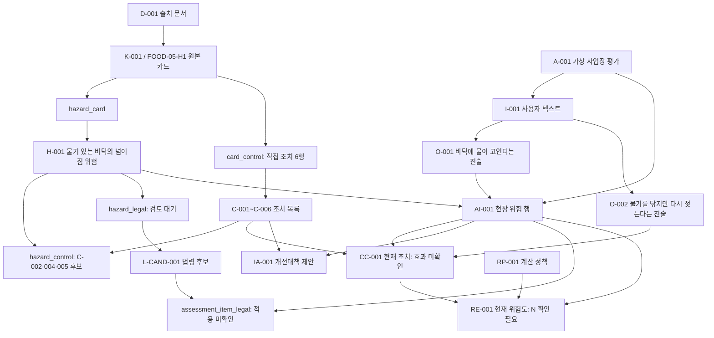

# 위험성평가 카드 데이터 구조 및 처리 흐름 제안

작성일: 2026-11-19  
대상: AI·백엔드·프론트엔드·데이터 담당 공통 공유  
상태: 설계 제안. DB 마이그레이션이나 서비스 연결을 완료했다는 의미가 아니다.

## 1. 핵심 결론

사용자 입력에서 작업 상황을 파악하고 관련 위험 후보를 검색한 뒤, 현장 적용 여부와 현재 조치를 확인하여 평가한다. 키워드 일치는 후보 검색의 단서이며 위험 확정이나 위험도 계산 결과가 아니다.

데이터는 **공통 기준 지식**과 **현장별 평가 결과**로 분리한다. 카드의 예방조치는 권장 조치이며 현장에서 이미 시행 중인 현재 안전조치가 아니다.

## 2. 현재 확인된 구현과 첨부 카드의 차이

확인 범위는 로컬 `SafeT-review-33-latest` 및 `SafeT-final-integration` 코드다. 운영 서버의 배포·환경설정·실모델 동작은 이번 분석에서 확인하지 않았다.

| 구분 | 확인 내용 |
|---|---|
| 기존 기준 데이터 | contracts/catalog_risk/catalog.json의 시나리오 26개. keywords, controls, severity 등을 포함 |
| 기본 경로 | 텍스트·음성 전사문·기계명에서 카탈로그 keywords 포함 여부로 후보 선택. 명시적 카탈로그 ID 선택도 지원 |
| AI 경로 | 사진의 기기 탐지 결과와 텍스트·전사문으로 기존 카탈로그 후보 선택. 기기 탐지만으로 누출·작동·현재 조치를 확정하지 않음 |
| 별도 input_based 모듈 | 기기 ID·키워드 검색 및 RAG 공급자 연결 지점 구현. 서비스 저장·확정 연결은 후속 통합 대상으로 기록 |
| 첨부 카드 | 116개: check 72개, case 33개, reference 11개. keyword 필드 없이 작업·기기·사고유형·embed_text 포함 |
| 카드 연결 여부 | 첨부 116개 카드가 현재 서비스 검색에 연결됐다는 근거는 확인하지 못함 |
| 위험도 | 신규 평가표 정책 FOOD-3LEVEL-1.2([합의 문서](../implementation/risk-development-agreement.md), 기존 평가표는 저장 당시 1.1)에 따른 피해 수준·조치 충족 상태 계산. 검색 점수와 분리 |

`embed_text`는 검색할 문장이다. 벡터가 아니며, 벡터 생성·색인·검색 구현이 있어야 의미 검색에 사용할 수 있다. 기존 rag_retrieval.candidates는 기기 ID별 사전 구축 연결 데이터를 조회하는 코드이므로 이름만으로 벡터 검색이라고 해석하지 않는다.

## 3. 권장 전체 흐름

아래는 첨부 카드를 활용하도록 확장할 때의 목표 흐름이다.

‘물기가 없다’와 ‘물기가 있다’는 같은 키워드가 포함되어도 다르게 처리해야 한다. 후보가 없거나 근거가 부족하면 안전하다고 처리하지 않고 확인 필요로 남긴다.

## 4. 테이블 설계 원칙

- 모든 ID는 안정적인 식별자다. 카드 원본 ID와 표준 위험요인 ID를 구분한다.
- 기준 데이터는 버전별로 보존한다. 아래 FK는 특정 버전 행의 ID를 가리킨다.
- 카드–위험, 위험–조치, 위험–법령은 다대다 관계이므로 연결 테이블을 둔다.
- 현장 관찰과 사용자 진술, AI 추정, 사용자 확인을 구분한다.
- 검색 신뢰도·관련도와 위험 등급은 별도 값이다.
- 이 문서의 예시 ID와 정규화된 문구는 설계용이다. 기존 DB에 이미 존재하는 ID가 아니다.
- null은 정보 미확보를 뜻한다. 빈 배열이나 미선택을 ‘없음’ 또는 ‘미실시’로 자동 해석하지 않는다.

## 5. 예시 카드와 가상 현장

### 5.1 실제 첨부 카드

| 필드 | 실제 값 |
|---|---|
| id / type | FOOD-05-H1 / check |
| 업종 / 구분 | 음식업 / 5. 바닥에서의 작업 |
| target | 이동 등 작업 |
| example_jobs | 조리, 청소, 가공, 설거지, 배식, 식자재 입고 및 보관, 이동 |
| 기기명·기기코드 | 모두 빈 배열 |
| risk_type | 넘어짐 |
| title | 바닥의 물기·기름기·이물질로 미끄러지거나 넘어짐 |
| text | 조리실·통로 바닥의 물기, 기름기, 음식물 찌꺼기, 장애물, 파손된 바닥재로 인한 넘어짐 위험 |
| source | 서비스업(건물관리·음식업)을 위한 재해사례 중심 위험성평가 실행 안내서 / 고용노동부·안전보건공단 / 2023 / 57쪽 |
| measures / measures_extra | 직접 조치 6개 / 보강 조치 없음 |
| laws | 산업안전보건기준에 관한 규칙 제3조(전도의 방지) 및 인용문 |
| deaths_3y | null |

법령 표기는 첨부에 기록된 내용이다. 현행성·정확한 항호·현장 적용 여부는 이번 문서에서 검증하지 않았다. 원본 source.page가 인쇄 쪽수인지 PDF 페이지인지도 추가 확인 대상이다.

### 5.2 설명용 가상 사용자 입력

> 설거지 구역 바닥에 물이 자주 고입니다. 물기를 닦고 있지만 작업 중 다시 젖습니다.

이 문장은 실제 현장 조사 결과가 아니다. 아래 A-001, I-001, O-001 등의 현장 데이터는 모두 설명용 합성 데이터다. 사진·음성은 이 예시에 없으므로 임의 파일이나 탐지 결과를 만들지 않는다.

## 6. 기준 데이터: 각 테이블에 들어갈 예시

### 6.1 문서·카드·위험요인

| 테이블 | 예시 행의 주요 필드 | 연결 의미 |
|---|---|---|
| source_document | id=D-001; title=서비스업(건물관리·음식업)을 위한 재해사례 중심 위험성평가 실행 안내서; publisher=고용노동부·안전보건공단; year=2023; file_hash=null | 문서 판본 한 개. 해시는 원본 파일 확보 후 기록 |
| knowledge_card | id=K-001; original_id=FOOD-05-H1; version=1; type=check; biz=음식업; section_no=5; section=바닥에서의 작업; target=이동 등 작업; source_document_id=D-001; page=57; page_kind=unverified; title/text=원문; raw_json=원본 객체 전체 | 원본의 배열·법령 문자열·검색 문장까지 손실 없이 보존 |
| hazard | id=H-001; version=1; task=젖은 바닥에서 이동; hazardous_condition=통행 바닥의 물기; event=넘어짐; description=설거지 구역의 물기 있는 바닥에서 이동 중 미끄러질 위험; potential_harm=넘어짐에 따른 부상; severity=null; review_status=draft | 카드에서 물기 관련 위험을 분리한 제안 초안. 피해 등급은 검수 전 미정 |
| hazard_card | hazard_id=H-001; card_id=K-001; role=check_basis; quote=조리실·통로 바닥의 물기, 기름기, 음식물 찌꺼기, 장애물, 파손된 바닥재로 인한 넘어짐 위험 | 이 위험이 어떤 카드로 뒷받침되는지 추적 |

원본 카드는 장애물·파손된 바닥재도 포함한다. 필요하면 별도 위험요인으로 나누되 모두 K-001에 연결한다. 카드 전체를 특정 현장의 사실로 복사하지 않는다.

### 6.2 조치 목록과 연결

`control`에는 원문 조치 6개를 각각 한 행으로 적재한다. 아래 문구는 실제 카드의 measures다.

| control.id | text |
|---|---|
| C-001 | 작업자가 이동 중 걸리거나 미끄러져 넘어질 위험이 있는 장애물 정리 |
| C-002 | 이동경로 내 물기, 기름기 등 제거(건조 상태 유지) |
| C-003 | 음식물 찌꺼기 등 이물질 제거 |
| C-004 | 미끄럼방지 바닥재 교체 또는 미끄럼방지용 액체 시공 |
| C-005 | 미끄럼방지 테이프 부착 |
| C-006 | 바닥재 또는 타일 파손시 교체 또는 보수 |

모든 control 행은 version=1, review_status=imported_unreviewed로 시작한다. 같은 문구라도 적용조건이 다르면 무조건 합치지 않는다.

| 테이블 | 예시 행 | 설명 |
|---|---|---|
| card_control | (K-001,C-001,direct,K-001)부터 (K-001,C-006,direct,K-001)까지 6행 | 순서대로 card_id, control_id, origin_kind, origin_card_id. 원문 표현과 순서도 보존 |
| hazard_control | (H-001,C-002), (H-001,C-004), (H-001,C-005) | 물기 위험에 관련된 조치 후보. 각각 critical=null, priority=null, review_status=draft |

장애물 정리·이물질 제거·바닥 보수는 카드 원문에 보존하되, 이 현장의 물기 위험에 모두 자동 적용하지 않는다. 관련성·핵심조치 여부를 검수한 뒤 계산에 사용한다. 핵심 여부가 null이면 계산 가능한 기준이 완성된 것으로 취급하지 않는다.

다른 카드의 measures_extra에 {text, from}이 있으면 origin_kind=supplemental, origin_card_id=from에 해당하는 카드 버전 ID를 기록한다. 보강 조치의 출처를 수신 카드의 문헌으로 바꾸지 않는다.

### 6.3 법령 근거

| 테이블 | 예시 행 | 상태 |
|---|---|---|
| legal_provision | id=L-CAND-001; law_name=산업안전보건기준에 관한 규칙; article=3; article_title=전도의 방지; paragraph=null; original_reference=첨부 laws의 원문 전체; effective_from=null; official_url=null; verification_status=unverified | 카드에서 가져온 후보. 검증된 현행 시행본이 아님 |
| hazard_legal | hazard_id=H-001; legal_provision_id=L-CAND-001; applicability_note=작업장 바닥의 물기 및 통행 조건 검토 필요; review_status=pending | 법적 적용을 확정하지 않은 연결 후보 |
| control_legal | 이 예시에서는 0행 | 특정 조치를 직접 의무화하는 근거는 별도 검수 전 생성하지 않음 |

운영 조회에서는 검증되지 않은 후보를 확정 법령으로 표시하지 않는다. 공식 원문 확인 후 시행일·항호·조건·URL·원문 해시가 있는 버전 행을 생성하고 검증된 연결로 교체한다. 과거 평가의 인용은 덮어쓰지 않는다. 법령·행정규칙·기술지침은 source_kind로 구분한다.

### 6.4 검색용 데이터

| 테이블 | 이 카드의 예시 | 이유 |
|---|---|---|
| equipment | 추가 행 없음 | 실제 카드의 기기 배열이 비어 있음 |
| equipment_alias | 추가 행 없음 | 임의로 식기세척기 등을 추정하지 않음 |
| hazard_equipment | 추가 행 없음 | 기기 없이도 작업·상태로 검색 가능해야 함 |
| hazard_term | (H-001,물기,상태), (H-001,젖은 바닥,상태), (H-001,설거지,작업), (H-001,미끄러짐,사고표현) | 설계용 검색어 후보. 부정 표현 검토는 별도 수행 |
| card_search_index | card_id=K-001; search_text=원본 embed_text; embedding=null; embedding_model=null; status=pending | 실제 벡터 생성 전에는 검색 인덱스 구축 완료로 표시하지 않음 |

equipment는 표준 기기, equipment_alias는 equipment_id+별칭/외부코드+코드체계, hazard_equipment는 hazard_id+equipment_id+적용조건을 관리한다. 예시에서 비어 있어도 테이블의 역할은 유지된다.

## 7. 현장 데이터: 각 테이블에 들어갈 예시

### 7.1 입력과 평가 행

| 테이블 | 예시 행의 주요 필드 |
|---|---|
| assessment | id=A-001; workplace_id=DEMO-SITE-001; assessed_at=2026-11-19; status=draft; revision=1; confirmed_at=null |
| input_asset | id=I-001; assessment_id=A-001; kind=text; original_text=위 가상 입력 전체; file_uri=null |
| observation | id=O-001; input_asset_id=I-001; kind=hazard_condition; quote=설거지 구역 바닥에 물이 자주 고입니다.; assertion_source=user_statement; verification_status=unconfirmed |
| observation | id=O-002; input_asset_id=I-001; kind=current_control; quote=물기를 닦고 있지만 작업 중 다시 젖습니다.; assertion_source=user_statement; verification_status=unconfirmed |
| assessment_item | id=AI-001; assessment_id=A-001; hazard_id=H-001; hazard_version=1; description=설거지 구역의 고인 물로 이동 중 미끄러질 위험; applicability=needs_confirmation; review_status=draft |
| assessment_item_observation | assessment_item_id=AI-001; observation_id=O-001; role=hazard_evidence |

문장 근거는 인용문과 함께 원문 문자 위치를 저장할 수 있다. 사진이면 이미지 영역, 음성이면 시작·종료 시각과 전사 버전을 저장한다.

### 7.2 현재 조치와 개선대책

| 테이블 | 예시 행의 주요 필드 |
|---|---|
| current_control | id=CC-001; assessment_item_id=AI-001; control_id=C-002; field_text=작업 중 물기를 닦음; reported_status=implemented; verification_status=unconfirmed; effectiveness=unknown; verified_by=null |
| current_control_observation | current_control_id=CC-001; observation_id=O-002 |
| improvement_action | id=IA-001; assessment_item_id=AI-001; control_id=C-004; plan_text=설거지 구역에 적합한 미끄럼방지 바닥재 적용 검토; status=proposed; selected_at=null; assignee=null; due_date=null |
| assessment_item_legal | assessment_item_id=AI-001; legal_provision_id=L-CAND-001; applicability_status=pending; citation_snapshot=첨부 법령 문자열; review_status=unverified |

물기를 닦는다는 진술만으로 ‘건조 상태 유지’ 조치가 유효하다고 확정하지 않는다. 이 예시는 다시 젖는다는 진술이 있으므로 효과 확인이 특히 필요하다. IA-001은 제안 상태이므로 선택된 개선대책으로도, 완료된 조치로도 처리하지 않는다.

목록의 다른 조치를 선택하지 않았다는 이유만으로 미실시라고 기록하지 않는다. 목록 검토 완료 여부와 미실시·미확인·비적용 상태를 구분한다.

### 7.3 위험도 정책과 계산 이력

| 테이블 | 예시 행의 주요 필드 |
|---|---|
| risk_policy | id=RP-001; version=CATALOG-MVP-1.1; method=피해 수준과 조치 충족 상태; matrix=아래 기존 정책표; source=backend/domain/risk_policy.py |
| risk_evaluation | id=RE-001; assessment_item_id=AI-001; kind=current; policy_id=RP-001; status=needs_information; severity=null; control_band=null; grade=null; signal=N; reason=피해 수준·핵심조치 기준 및 현장 적용·조치 효과 확인 필요 |
| risk_evaluation | 예상 결과 행은 아직 생성하지 않음 | 

현재 코드의 정책표는 다음과 같다. 이는 프로젝트의 서비스 정책이며 법정 산식이라는 의미가 아니다.

| 피해 수준 | 필요한 조치 모두 유효 C1 | 핵심 유효·보완 미흡 C2 | 핵심 결여·무효 C3 |
|---|---|---|---|
| 경미 S1 | 하 | 중 | 중 |
| 치료·회복 필요 S2 | 중 | 중 | 상 |
| 사망·영구장해 가능 S3 | 상 | 상 | 상 |

첨부 카드만으로 H-001의 severity나 critical을 채울 수 없다. 기존 26개 카탈로그와의 대응, 적용조건, 핵심조치를 검수해야 한다. 미완성 기준을 기존 evaluate 함수에 그대로 넘기지 않고 needs_information을 반환하도록 서비스 계층에서 처리한다.

계산이 가능해지면 risk_evaluation에 사용한 hazard/control 버전, 평가 revision, 입력 상태 스냅샷, 정책 버전, 계산시각·이유를 보존한다. 이후 조치 변경 시 새 계산 행을 추가한다.

- current: 실제 확인된 현재 조치 기준.
- projected: 선택된 대책이 모두 이행되어 효과가 있다는 가정의 결과.
- actual_after: 향후 실제 이행과 효과를 확인한 후의 결과. 현재 프로젝트 합의상 후속 범위.

개선대책을 선택했다고 현재 등급이나 완료 상태를 변경하지 않는다. 기준 control_id와 연결되지 않은 직접 추가 대책은 저장하되 자동 하향 계산에는 사용하지 않는다.

## 8. 예시 ID 연결도

## 9. 최종 평가표에 보이는 형태

아래는 가상 입력으로 만든 **미확정 초안**이다.

| 위험요인 | 현재 안전조치 | 개선대책 | 현재 위험도 | 예상 위험도 | 법령 근거 |
|---|---|---|---|---|---|
| 설거지 구역의 고인 물로 이동 중 미끄러질 위험 | 물기를 닦고 있다는 사용자 진술. 건조 상태 유지 효과 미확인 | 미끄럼방지 바닥재 적용 검토 — 제안, 미선택 | 확인 필요 N | 미산정 | 첨부의 안전보건규칙 제3조 표기 — 현행성·적용 미확인 |

화면에는 한 행으로 보여도 DB는 여러 테이블에서 조합한다. 조치와 법령이 각각 여러 개일 때 JOIN 결과가 곱으로 늘어나지 않도록 각각 집계한 후 평가 행에 연결한다.

## 10. 이관 시 주의사항과 구현 순서

### 데이터 점검 결과

- 116개 카드 ID는 중복이 없었고 measures_extra.from은 첨부 안의 카드 ID를 참조했다.
- measure_count는 measures와 measures_extra의 합과 일치했다. DB에서는 연결 행에서 계산한다.
- 75개 카드에서 machine_names와 machine_codes의 길이가 달랐다. 배열 순서로 일대일 연결하지 않는다.
- laws가 있는 카드는 9개다. 나머지 빈 배열은 ‘관련 법령 없음’이 아니라 ‘미수록’으로 취급한다.
- deaths_3y는 여러 카드에 같은 집계가 반복될 수 있다. 합산하거나 개별 현장의 위험 점수로 사용하지 않는다. 통계를 활용할 때는 별도 statistic 테이블에 기간·대상·단위·출처를 보존한다.
- check에도 예방수칙 형태의 항목이 있고 reference에는 통계가 있다. 카드 유형만으로 표준 위험요인을 자동 확정하지 않는다.

### 권장 작업 순서

1. 원본 JSON 전체와 카드 버전을 보존한다.
2. 카드별 출처와 직접/보강 조치를 분리한다.
3. 기존 카탈로그 26개와 카드 116개의 다대다 대응표를 검수한다. 일치하지 않는 카드를 억지로 연결하지 않는다.
4. 위험별 적용조건·피해 수준·핵심조치 기준을 검수한다.
5. 현장 입력→관찰 근거→평가 행→현재 조치 확인을 연결한다.
6. 기존 공통 계산 모듈에 검수된 기준을 공급하고 정책·입력 스냅샷을 보존한다.
7. 검색 사전과 필요 시 의미 검색을 추가한다. 부정 표현·미매칭·기기만 존재하는 반례로 검증한다.
8. 공식 법령의 시행본·적용조건 검증 후 법령 후보를 확정 근거로 연결한다.

테이블명은 논리 설계 예시다. 기존 risk_catalog, eval_dtl, eval_action, risk_event 및 catalog_state와의 중복을 대조한 뒤 점진적으로 반영한다. 서비스 전체를 즉시 교체하는 안은 아니다.

## 11. 확인한 자료

- 첨부: `risk_card_data.md` (116개 JSONL 카드)
- 로컬 검토본: `07_실험과_개발/SafeT-review-33-latest`
- `backend/services/catalog_risk.py`: 카탈로그 적재·검색·조치 확인·재계산
- `backend/services/catalog_ai.py`: 사진 탐지 결과·텍스트·음성 전사문 전달
- `backend/services/rag_retrieval.py`: 기기 ID 기반 문헌 근거 후보 조회
- `backend/domain/risk_policy.py`: 공통 정책 계산
- `contracts/catalog_risk/catalog.json`: 기존 시나리오 26개
- `ai/assessment_authoring/README.md`: 별도 검색·검증·계산 모듈의 구현 범위
- `docs/implementation/risk-development-agreement.md`: 현재·예상 위험도 구분

이번 작업은 첨부 데이터 및 코드의 읽기 분석과 설계 문서 작성이다. 서비스 코드·DB·운영 데이터는 변경하지 않았다. 법령 현행성, 현장 정확도, 실제 모델·서버 동작은 검증 범위에 포함하지 않는다.
