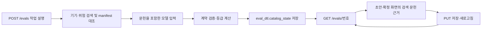

# 검색 근거의 화면·DB 연결

`SAFET_ASSESSMENT_MODE=authoring_rag_v1`에서 입력 기반 파이프라인을 기존 평가표 API에 연결한다. 기존 `catalog_v1`, `catalog_ai_v1` 흐름은 유지한다.



## 저장 계약

| 위치 | 내용 |
|---|---|
| `eval_mst.generation_source` | `authoring_rag_v1` |
| `eval_dtl.curr_risk_grade` | 입력 기반 상/중/하에 대응하는 R/Y/G |
| `eval_dtl.catalog_state.authoring` | 정책·모델·생성시각, 부분 결과 상태, 미매칭 후보, 분석·표시 행 |
| `authoring.row.document_evidence` | 문장, 출처·연결 행 ID, 문서명, PDF 쪽, 데이터 버전·인덱스 해시 |
| `eval_action`의 P 행 | 사용자 개선계획 선택 |

GET 응답은 항목의 `assessment_mode`, `authoring`, `document_evidence`를 반환한다. 근거는 생성 당시 스냅샷으로 저장하므로 파일 갱신·서버 재시작 후에도 과거 평가표의 출처가 바뀌지 않는다. 기존 `catalog_state`를 활용하며 추가 migration은 없다.

저장 요청은 기존 revision·조치·담당·예정일만 받는다. 문헌·등급·분석 필드는 클라이언트 수정 대상이 아니다. 입력 기반 현재 조치도 임의로 덮어쓸 수 없다. 개선계획 선택은 현재 위험도를 바꾸지 않으며 실제 이행 완료로 처리하지 않는다. 확정 시 계획·담당·예정일 검증은 유지하고 현재 조치의 추가 확인은 요구하지 않는다.

## 실행

개인 로컬 DB에 팀 ERD와 기존 migration, 카탈로그를 준비한다. DB·JWT·모델 인증은 기존 환경변수 또는 비공개 `.env`로 설정한다.

```text
SAFET_ASSESSMENT_MODE=authoring_rag_v1
SAFET_RAG_DIR=<비공개 검색 데이터 폴더>
SAFET_AI_GATEWAY_URL=<기존 AI 관문>
SAFET_AI_MODEL=<관문 모델명>
SAFET_AI_API_KEY=<비공개 인증 키>
```

```powershell
python backend/run_local.py --authoring-rag --migrate
```

기본 실행 주소는 화면 8000·API 8001이다. 비공개 폴더에는 동일 manifest의 검색 인덱스 v2와 기기-위험요인 연결 행 v2가 필요하다. evaluation_only 자료는 읽지 않는다. 개인 로컬 DB에서만 위 명령을 실행한다.

## 확인 순서

1. `주방에서 튀김기로 조리를 합니다.`를 입력한다.
2. 초안의 화상·미끄러짐 항목에서 입력 근거와 검색 문헌이 구분되어 보이는지 확인한다.
3. 개선계획을 선택하고 저장·새로고침한다. 문장·출처·PDF 쪽·현재 등급이 같아야 한다.
4. 계획 담당자·예정일 지정 후 확정한다. 확정 결과 화면에서도 같은 근거가 보여야 한다.
5. 로컬 API를 재시작하고 평가표를 다시 조회한다.

## 파일과 검사

- [authoring_rag.py](../../backend/services/authoring_rag.py): 입력 변환, 검색·모델 연결, 스냅샷, 현재 상태 보호.
- [assessment.py](../../backend/services/assessment.py): 생성·저장·재조회·확정 트랜잭션 연결.
- [catalog-ai.js](../../frontend/js/catalog-ai.js): 입력 근거와 문헌을 구분하여 텍스트로 표시.
- [draft.js](../../frontend/js/draft.js), [assessment-result.js](../../frontend/js/assessment-result.js): 초안·확정본 표시.
- [DB 통합 검사](../../backend/tests/test_authoring_rag.py), [연결 검사](../../backend/unit_tests/test_authoring_rag_adapter.py).

격리 `_test` DB에서 다음 명령을 실행한다. 자동 회귀 검사는 합성 응답을 사용하며 실제 모델 검사와 구분한다.

```powershell
python -m pytest backend/tests/test_authoring_rag.py backend/unit_tests/test_authoring_rag_adapter.py -q
```

검사 범위: 근거 동일성, 계획 저장 후 등급 유지, 미확인 보존, 변조 거절, revision 충돌, 검색 장애 시 저장 중단, 중복 생성 방지, 확정 잠금, 연결 파일 해시·역할 검사.

## 현재 범위

- 텍스트·음성 전사문만 연결한다. 사진·직접 카탈로그 선택은 명시적으로 거절한다.
- 입력에서 직접 언급한 튀김기의 `burn→FRY`, `slip→ENV`만 실제 기기 RAG에 연결한다. 보유 기기를 현재 작업으로 간주하지 않는다.
- 가스·호흡기 후보는 미매칭으로 보존하고 결과를 `partial`로 표시한다. A등급 직접 언급 문장만 사용하며 섹션만으로 연결된 다른 기기 문장은 제외한다.
- 새 모드의 위험 추가·질문 답변 API는 사용하지 않는다. 새 작업은 새 평가표로 작성한다.
- PDF·공유 문서의 근거 표시, 사진 인식, 전체 기기 매핑 확대는 이번 연결 범위에 포함하지 않는다.

## 근거 표시 보강

- 판단 이유(`explanations.rationale`)에는 입력에서 확인한 작업·조치 상태와 현재 위험도 계산 이유만 쓴다. 문헌 위험 설명·예방대책은 검색 문헌 근거 영역에서 요약·출처 쪽수와 함께 표시한다.
- `authoring.row.control_details`: 기준 조치마다 상태(실시 확인 / 고장·미실시 또는 효과 부족 / 미확인)와 판단에 쓴 입력 원문을 담는다. 미확인 조치는 원문 없이 표시한다. 이 필드가 없는 이전 저장본은 조회 시 저장된 조치 상태와 기준 문구로 만든다.
- 확정 화면은 `work_review.excluded_candidates`를 "검토 후 제외한 작업"으로 한 번만 표시한다(예: 튀김 조리 · 현장 비적용). 제외 기록이 없으면 영역을 숨긴다.
- 검사: `python -m unittest discover -s ai/assessment_authoring/tests`, 격리 `_test` DB에서 `python -m pytest backend/tests/test_authoring_rag.py -q`.
