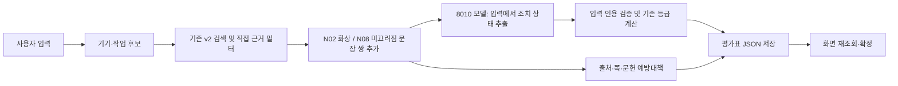

# N02·N08 검색 문맥 연결

기존 v2 인덱스·연결 파일을 그대로 사용하고, 검수한 문장 쌍을 `N02-N08-context-1`로 추가한다. CATALOG-MVP-1.1 등급 계산과 개선대책 후보는 변경하지 않는다.

| 자료 | 원문 확인 | 이번 연결 | 제외 |
|---|---|---|---|
| N02, KOSHA G-68-2011 | PDF 11~13쪽 / 인쇄 9~11쪽 | PDF 12쪽: 냉각 전 기름 교환 화상 → 충분히 냉각 후 교환 | 앞뒤의 제면기·육류절단기, 소화기 권고, 현행성 미검증 법령 |
| N08, 급식실 안전보건점검표 해설서(2012) | PDF 7·21쪽 / 인쇄 1·15쪽 | PDF 7쪽: 튀김 작업 주변 바닥 기름에 미끄러짐 → 기름·물기 수시 청소 | PDF 21쪽 후드 청소 중 추락을 바닥 미끄러짐으로 연결하지 않음 |

원본 PDF 2개는 기존 출처 기록의 SHA-256과 일치했다. 연결한 위험·예방 문장은 공백을 제외하고 원본 PDF 추출문과 일치하며 페이지 이미지도 대조했다. 법령 RAG 또는 현행 법적 적합성 검증으로 해석하지 않는다.

## 변경 파일

- `ai/assessment_authoring/reference_expansion.py`: 별도 manifest의 버전·해시·검수 페이지 검사, 기존 결과 복사 후 추가. 문헌당 한 문장 쌍, 위험 항목당 확장 문헌 하나. 벡터 검색이나 임의 top_k 확장이 아니다.
- `backend/services/authoring_rag.py`: 선택적 확장 설정과 스냅샷 버전·해시 저장.
- `ai/assessment_authoring/explanations.py`: 위험 요약과 예방대책을 구분해 구성.
- `frontend/js/catalog-ai.js`: 예방대책·발행자료 안내·출처·페이지·원문 표시.
- `ai/assessment_authoring/mappings/catalog_links.json`: ‘칼로 채소/식재료’ 입력의 칼 작업 누락 보완. 튀김기 미사용은 튀김 위험으로 연결하지 않음.
- `ai/assessment_authoring/tests/test_reference_expansion.py`: 이전 결과 보존, 문맥 구분, 위변조 거절, 미사용 입력 검사.

## 실행 설정

`SAFET_RAG_CONTEXT_DIR`을 저장소 밖 검수 데이터 폴더로 지정한다. 미설정하면 기존 v2 동작이다. 설정했는데 데이터가 손상되면 503으로 중단하며 조용히 기존 결과로 대체하지 않는다.

폴더에는 `manifest.json`과 `contexts.json`을 둔다. manifest는 version=`N02-N08-context-1`, file=`contexts.json`, 해당 파일 sha256을 갖는다. 각 문맥은 doc_id, hazard_code, source_id, source_file, pdf_pages, printed_pages, published_year, source_sha256, hazard_text, prevention_text, review_status=`pdf_verified`를 갖는다. 검수된 파일 쌍만 배포 대상으로 삼고 원본 PDF·비공개 검색 자료·자격증명은 저장소에 넣지 않는다. 기존 확정본은 생성 당시 스냅샷을 유지한다.

## 실제 검수 결과

- 기본 입력: ‘주방에서 튀김기로 조리를 합니다.’
- 실제 모델: 기존 8010의 EXAONE 3.5 7.8B AWQ. 두 시나리오를 개별 호출했다.
- ENV: 입력 3,066 / 출력 421토큰, FRY: 입력 3,017 / 출력 695토큰. 각 호출 4,096 한도 이내.
- 모델 입력 reference_documents와 최종 저장 document_evidence의 전체 내용 일치 확인.
- 로컬 평가표 42, revision 3, 확정 상태. 화면에서 계획 선택 → 저장 → 재조회 → 담당·기한 지정 → 확정 → 다시 열기 통과.
- 문헌 예방대책을 전달해도 현재 조치 8개씩은 unknown 유지. 문헌을 현장 시행 증거로 승격하지 않음.
- 기존 v2 인덱스·연결 파일 해시 보존 확인.
- 파이프라인 단위검사 44개, 계약검사 33개, DB·어댑터 검사 8개, CPU 자체검사 3개 통과.

8010 복구 후 추가 입력 세 건의 첫 호출에서 조치 누락, 입력에 없는 인용, 조치 간 근거 혼입을 확인했다. 모델이 스키마에 등록된 후보·조치·입력 문장 ID를 선택하도록 바꾸고 서버에서 원문을 복원한다. FRY·ENV·KNIFE는 참조 문장에 해당 조치의 용어가 나타나는지도 검사한다. 문헌은 모델 요청과 평가표에 별도 필드로 전달한다.

| 입력 | 로컬 평가표 | 재조회 결과 |
|---|---:|---|
| 기름을 충분히 식힌 후 배유 | 56 | FRY-C2만 실시 확인. FRY·ENV의 나머지 조치는 미확인 |
| 온도 제어 장치 고장 | 57 | FRY-C1만 미실시·효과 없음. FRY·ENV의 나머지 조치는 미확인 |
| 튀김기 미사용, 칼로 채소 절단 | 58 | 칼 작업만 생성. 조치 6개 모두 미확인. 튀김기 근거 없음 |

세 건 모두 개선대책 선택, 화면 저장, 새로고침, DB 재조회(revision 2)를 통과했다. 튀김기 두 건에서 모델 요청과 재조회된 문헌 근거가 일치했고 화면에서 예방대책을 다시 확인했다. 실제 모델 호출 5회, 최대 총 1,842토큰이었다. 기존 등급 계산에서 나머지 핵심 조치가 미확인이므로 이 검수에서 각 위험도는 상이었다.

조치 용어 검사는 검수한 세 시나리오에 적용한다. 등록되지 않은 동의어는 미확인으로 남을 수 있다. 이번 재검수는 초안 저장까지 수행했다. 기본 사례 42의 최종 확정 결과는 위에 기록했다.

사진·음성 원본 인식, 법령 현행성, PDF/한글 출력은 이번 확장 검수 범위에 포함되지 않는다. 클라우드 8020 배포 및 운영 DB 변경 없음.
