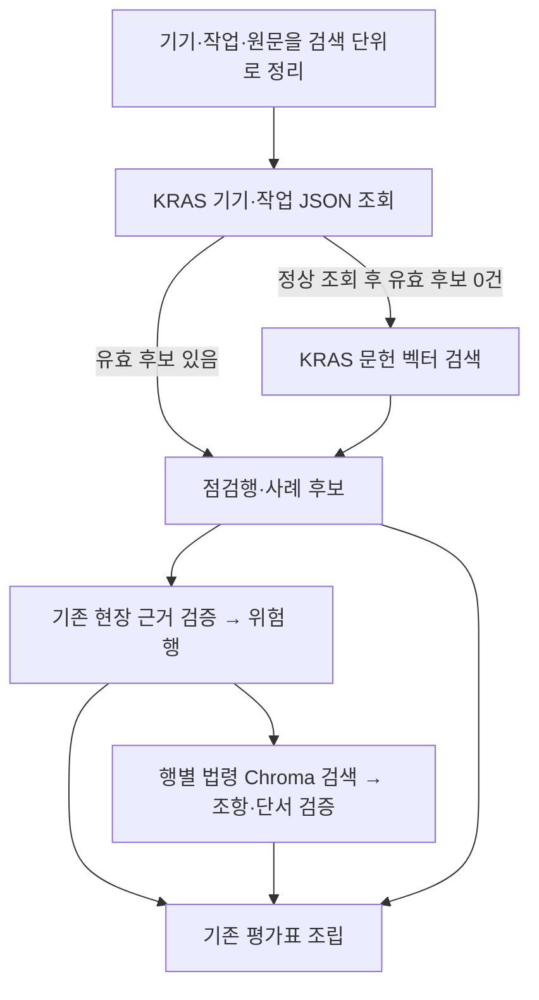

# 음식점 법령·KRAS 검색 모듈 계약 v1

사례 검색 담당은 [KRAS 시작 안내](KRAS.md)에서 시작한다. [태그 사전](tags.json), [입출력 예제](fixtures.json), [검증 스키마](contract.schema.json)를 같은 커밋에서 사용한다.

**법령 담당은 “이 작업에 어떤 기준이 어떤 조건에서 적용되는가”를 반환한다. KRAS 담당은 “어떤 위험을 점검하고 어떤 조치를 고려할 수 있는가”를 반환한다.** 두 모듈은 같은 입력 예제로 독립 개발한다. 통합 시에는 같은 검색 단위의 응답을 모으고, 태그와 현장 문맥을 대조해 위험 행에 근거를 붙인다.

## 1. 먼저 고정할 두 가지

| 합의 | v1 규약 |
| --- | --- |
| 공통 태그 | 키는 `process_tag`, `hazard_tag`. 값은 아래 영문 코드의 배열. 화면에서는 한국어 이름을 쓴다. |
| 입출력 | `safet-evidence/1.0.0`과 `restaurant-tags/1.0.0`을 함께 전달한다. [JSON Schema](contract.schema.json)는 공통 요청·법령 응답·KRAS 응답 중 하나를 검사한다. |

이 계약의 범위는 **두 검색 모듈과 통합 어댑터 사이**다. [기존 SafeT 검색 계약](https://github.com/chaechae001/SafeT/blob/1b1240e/contracts/assessment_authoring/v1/INTERFACES.md)은 평가표 API 쪽에서 계속 사용한다.

### 태그 사전

**작업 태그**  
`move` 통로 이동 · `store` 입고·보관·인출 · `carry` 운반·적재 · `hand_prep` 수작업 손질·칼질 · `machine_prep` 기계 가공·혼합 · `cook` 가열·조리 · `oil_change` 기름 교환·배유 · `serve` 배식·서빙 · `wash` 설거지·세척 · `clean` 청소·소독 · `maintain` 점검·정비 · `deliver` 배달 운전 · `customer` 고객 응대 · `manage` 평가·교육·관리

**위험 태그**  
`slip` 미끄러짐·같은 높이 넘어짐 · `fall` 높이에서 떨어짐 · `burn` 고온 접촉·열탕 화상 · `cut` 베임·절단 · `caught` 끼임·말림 · `struck` 낙하물·물체에 맞음 · `trapped` 갇힘 · `msd` 근골격계 부담 · `poison` 흡입·중독 · `asphyxia` 산소결핍·질식 · `chemical_burn` 화학 화상 · `shock` 감전 · `fire` 화재 · `explosion` 폭발 · `heat_stress` 온열질환 · `cold_stress` 한랭장해 · `radiation` 자외선 등 광선 노출 · `traffic` 교통 충돌 · `psychosocial` 정신적 부담·폭언

- 하나의 조항·점검행에 여러 태그를 허용한다. 배열 안에는 같은 코드를 한 번만 넣는다. 정보가 부족하면 빈 배열 `[]`을 쓴다. 빈 배열을 모든 위험과 일치한다고 해석하지 않는다. 범용 절차 문서에는 `manage`와 빈 위험 배열을 쓸 수 있다.
- 동의어는 원문을 보존하면서 코드로 정규화한다. ‘배유·폐유 교환’ → `oil_change`, ‘베이다·절상’ → `cut`. ‘물기’만으로 위험을 고르지 않는다. 젖은 바닥을 걷는 문맥은 `slip`, 젖은 손으로 전기기기를 조작하는 문맥은 `shock`이다.
- `EQ_FRYER`는 기기 ID, `FRY`와 `ENV`는 기존 카탈로그 시나리오 ID다. 어느 것도 위험 태그로 넣지 않는다. 기존 `hazard_code`는 어댑터에서 문맥을 확인해 공통 태그로 변환한다. 예를 들어 `burn`은 고온 접촉, 세척제에 의한 화학 화상은 `chemical_burn`이다. [기기·시나리오 매핑](https://github.com/chaechae001/SafeT/blob/1b1240e/ai/assessment_authoring/mappings/catalog_links.json)
- 원문에서 분류하기 어려운 단어는 원문과 함께 미매핑 목록에 남긴다. 새 코드·의미 변경은 두 담당자가 사전과 예제를 함께 검토한다. 코드 추가는 태그 사전의 minor, 삭제·의미 변경이나 필수 필드 변경은 해당 계약의 major를 올린다. v1 소비자는 지원하지 않는 버전을 오류로 반환한다.

## 2. 각자 만들 부분

| | 법령 담당 · 법령 | KRAS 담당 · KRAS |
| --- | --- | --- |
| 자료 | 법령·고시 8개 분야, 보유 HWPX 9개 및 적용에 필요한 하위법령·별표 | 음식점 KRAS 표준모델의 공정별 점검표와 출처가 확인된 재해사례. 자료마다 문서명·판본·원문 위치 기록 |
| 청킹 단위 | 조는 부모, 검색 단위는 항·호·목. 별표는 행과 열 제목·비고를 함께 복원. 단서·적용 범위·시행일 보존 | 점검표는 한 점검 항목과 그 조치가 한 단위. 병합 셀의 공정명과 열 제목은 상속. 사례는 한 사건의 작업·상황·피해·예방대책을 연결. 빈 칸은 추정하지 않음 |
| 검색 | 검증된 위험 행의 작업·위험 설명으로 법령 컬렉션 벡터 검색. 평가일 유효성·대상·제외 조건을 검사 | 기기·작업별 JSON 인덱스 우선. 정상 조회 후 유효 결과가 0건인 대상만 KRAS 컬렉션 벡터 검색. 다른 기기에 적중했어도 미적중 대상은 독립 처리 |
| 출력 | 조문·원문 발췌·출처·조건 상태·연결 이유 | 위험 후보·점검 문항 또는 사례·개선 후보·출처 |
| 제출 | 법령 응답 예제, 조항 복원 검사, 적용 조건 부족·개정 경계 사례 | 두 자료 유형의 응답 예제, 점검표 행 복원 검사, JSON 적중·0건·오류 사례 |
  
LangChain과 Chroma를 쓰되 컬렉션·원문 저장소·실험 버전은 모듈별로 관리한다. LangGraph는 사용하지 않는다. 기존 검색 정답에 쓰인 CASE 자료와 그 복제본은 JSON·벡터 코퍼스 양쪽에서 제외한다. [기존 JSON 검색기](https://github.com/chaechae001/SafeT/blob/1b1240e/backend/services/rag_retrieval.py)

## 3. 입력과 출력 예제

공통 예제의 입력은 **“튀김기 옆 기름 묻은 통로로 식재료를 나릅니다.”**이다. 이 예제에서는 통로 이동만 한 검색 단위로 떼어낸다. KRAS 점검 문구와 모든 fixture ID는 연결 시험용이다. 법령 발췌의 원문은 [안전보건규칙 제3조](https://www.law.go.kr/법령/산업안전보건기준에관한규칙/제3조)다.

**두 모듈의 공통 입력**

```json
{
  "contract_version": "safet-evidence/1.0.0",
  "tag_version": "restaurant-tags/1.0.0",
  "request_id": "demo-01",
  "unit_id": "passage-01",
  "as_of": "2026-11-19",
  "work_text": "튀김기 옆 기름 묻은 통로로 식재료를 나릅니다.",
  "work_status": "supported",
  "scenario_id": "ENV",
  "equipment_ids": [
    "EQ_FRYER"
  ],
  "process_tag": [
    "move"
  ],
  "hazard_tag": [
    "slip"
  ],
  "facts": [
    {
      "id": "TEXT:1",
      "text": "튀김기 옆 기름 묻은 통로로 식재료를 나릅니다."
    }
  ]
}
```

호출자가 `request_id`를 발급한다. `unit_id`는 한 요청 안에서 한 기기·작업·위험 문맥을 가리킨다. 최초 KRAS 조회에서는 `scenario_id: null`, 위험 태그 빈 배열도 유효하다. 작업이 확인된 후 법령 요청에는 해당 위험 행의 문맥과 ID를 넣는다. 한 초기 단위에서 여러 위험 행이 생기면 각 행에 새 단위 ID를 주고 통합기가 원래 KRAS 항목의 evidence_id를 보관한다. `facts`에는 현장 입력·검증된 사업장 정보만 넣는다. 업종만으로 인원·설비·현재 조치를 추정하지 않는다.

**KRAS 담당이 반환할 KRAS 응답**

```json
{
  "contract_version": "safet-evidence/1.0.0",
  "tag_version": "restaurant-tags/1.0.0",
  "request_id": "demo-01",
  "unit_id": "passage-01",
  "module": "kras",
  "corpus_version": "fixture-k1",
  "route": "json",
  "status": "ok",
  "error_code": null,
  "items": [
    {
      "process_tag": [
        "move"
      ],
      "hazard_tag": [
        "slip"
      ],
      "evidence_id": "kras:fixture-k1:check:1",
      "source_version": "fixture-k1",
      "quote": "통로 바닥의 기름을 제거했는지 점검한다.",
      "kind": "checklist",
      "document_id": "DEMO-K",
      "document_title": "연결 시험용 합성 점검표",
      "locator": "점검표 1행",
      "hazard_description": "기름 묻은 통로 이동 중 미끄러짐",
      "check_item": "통로 바닥의 기름을 제거했는가?",
      "measure_candidates": [
        "통로 바닥의 기름을 제거한다."
      ]
    }
  ]
}
```

`checklist`는 점검 문항을 채운다. `case`는 `check_item: null`과 사건의 위험 설명을 보낸다. `measure_candidates`에는 해당 출처에서 뒷받침되는 조치만 넣고 없으면 빈 배열로 둔다. 여러 원문이 필요하면 출처별 item으로 나눈다. 실제 자료의 `locator`는 PDF 쪽·표·행 또는 사례 번호로 사람이 다시 찾을 수 있어야 한다.

**법령 담당이 반환할 법령 응답**

```json
{
  "contract_version": "safet-evidence/1.0.0",
  "tag_version": "restaurant-tags/1.0.0",
  "request_id": "demo-01",
  "unit_id": "passage-01",
  "module": "law",
  "corpus_version": "fixture-l1",
  "route": "vector",
  "status": "ok",
  "error_code": null,
  "items": [
    {
      "process_tag": [
        "move"
      ],
      "hazard_tag": [
        "slip"
      ],
      "evidence_id": "law:fixture-l1:rules:3:1",
      "source_version": "고용노동부령 제450호",
      "quote": "작업장 바닥 등을 안전하고 청결한 상태로 유지하여야 한다.",
      "law_name": "산업안전보건기준에 관한 규칙",
      "locator": "제3조제1항",
      "url": "https://www.law.go.kr/법령/산업안전보건기준에관한규칙/제3조",
      "effective_from": "2026-03-02",
      "applicability": "supported",
      "reason": "입력의 기름 묻은 통로와 조문의 작업장 바닥 미끄러짐 방지 기준이 연결된다.",
      "missing_conditions": []
    }
  ]
}
```

`effective_from`은 인용한 원문 판본의 시행일이다. 조문별 유예·경과조치는 `as_of` 기준으로 별도 검사한다. 필수 조건이 비면 `conditional`과 구체적인 `missing_conditions`를 보낸다. 확인된 비적용 조항은 제외한다. 원문 ID·URL·발췌·시행일은 서버가 원본으로 복원하고 한국어 모델은 연결 이유를 작성한다. 모든 item의 `evidence_id`는 모듈·판본·원문 위치를 식별하는 안정 ID이며 같은 판본·위치를 재처리해도 유지한다.

## 4. 결합과 실패 처리



1. **요청 식별.** 두 버전과 요청·단위 ID를 검사한다. 다른 요청의 같은 태그는 결합하지 않는다. 같은 근거 ID가 여러 번 나오면 한 번 표시하고, 한 근거가 서로 다른 행을 뒷받침할 때에는 각 행에 참조를 남긴다.
2. **후보 선별.** 태그는 문맥 정규화·순위 보조에 사용한다. 같은 기기라도 미끄러짐 행에 화상 문헌을 붙이지 않는다. 일반 바닥 안전조항은 기기 태그가 없어도 관련 원문과 조건이 맞으면 사용할 수 있다. 태그가 같다는 이유만으로 조문을 채택하지 않는다.
3. **행 조립.** 위 사례의 `ENV` 행에는 KRAS의 기름 제거를 ‘개선 후보’, 법령의 바닥 청결 기준을 ‘관련 법령’에 넣는다. 입력에는 제거를 이미 했다는 진술이 없으므로 현재 조치는 미확인이다. 기존 최초 AI 근거와 현재·예상 등급은 CATALOG-MVP-1.1 경로에서 처리한다.
4. **기존 계약 연결.** 법령 참조를 검증한 뒤 기존 `legal_refs`에는 허용된 `legal_id`·`url`을 투영한다. 상세 발췌·조건·판본과 KRAS 출처는 별도 근거 상세에 보존한다. 기존 `source_refs`는 등록 문서·쪽 검증을 통과한 경우에만 채운다. 원본 계약의 추가 필드 제한을 지킨다.

| 응답 상태 | 필수 동작 |
| --- | --- |
| ok | item 1개 이상. 법령은 각 item에서 supported / conditional 구분 |
| no_evidence | 검색은 정상 종료, 채택 가능한 근거 0건. items는 빈 배열 |
| skipped | 미사용·호출 대상 아님 등으로 검색 생략. route도 skipped. 현장 미확인 후보에 법령 의무를 확정해 붙이지 않음 |
| error | 인덱스 누락·해시 불일치·검색기 장애·버전 불일치 등을 error_code에 기록. 장애를 정상 0건으로 처리하거나 JSON 장애로 벡터 fallback을 호출하지 않음 |

`error_code`는 error에서만 값이 있다. `route`는 마지막 시도 경로, 검색 전에 버전 오류가 난 경우에는 요청한 모듈의 최초 경로다. `corpus_version`은 요청에 사용하도록 설정한 자료 판본이다. 한 모듈이 실패해도 다른 모듈의 성공 근거를 보관하고 실패한 모듈 상태를 표시한다.

## 5. 시작 순서와 완료 기준

1. **같은 날 독립 착수.** 양쪽이 [스키마](contract.schema.json)와 fixture를 사용한다. 법령 담당은 공통 요청과 KRAS 고정 응답으로 법령을 개발하고, KRAS 담당은 같은 요청과 법령 고정 응답으로 KRAS를 개발한다. KRAS 담당은 먼저 실제 음식점 점검표 한 행과 사례 한 건의 출처·발췌를 확보한다.
2. **각 모듈 제출.** 각자 동일 입력에 대한 실제 응답, 원문 위치, 자료 버전, 실행 방법을 제출한다. 정상·0건·오류와 모듈별 경계 사례가 스키마 및 내용 검사를 통과해야 한다. 합성 fixture와 실제 검색 결과를 구분한다.
3. **통합 검수.** 아래 사례를 통과하면 실모델에서 대표 한 건을 생성해 저장 → 재조회 → 확정 → PDF를 대조한다. 위험 행, 현재 조치, 등급, 두 출처와 발췌가 기대대로 유지되는지 확인한다.

| 시험 입력·조건 | 기대 결과 |
| --- | --- |
| 기름 묻은 통로, JSON 적중 | KRAS 벡터 호출 0회. 미끄러짐 문헌과 바닥 조문이 같은 행에 연결 |
| 정상 JSON 0건 / 파일 손상 | 전자는 KRAS 벡터 검색, 후자는 error. 재시도해도 근거 중복 없음 |
| 튀김기 사진 + “튀김은 하지 않습니다” | 미사용 의사를 보존. 튀김 작업에 대한 확정 법령 없음 |
| 적용에 필요한 규모 미상 | 확인된 조건만 사용. 조건부 항목에 누락된 사실 명시 |
| 점검표에만 “청소했는가”가 있음 | 현재 조치를 실시로 기록하지 않음 |
| 다른 unit_id / 출처 ID 위조 / quote 불일치 | 잘못 연결한 항목 차단. 정상 근거는 보존 |
| 법령만 0건, KRAS 적중 | KRAS 근거 표시. 법령 영역에는 확인된 근거가 없다고 표시 |

법령 파서 실행은 [법령 시작 안내](LAW.md)를 따른다.
